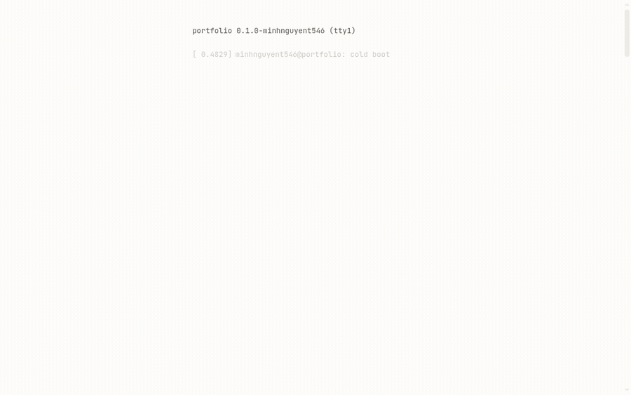

# Portfolio

Personal portfolio for research, publications, engineering projects, and technical writing. Built with [Astro 7](https://astro.build/) and deployed to GitHub Pages.



## Overview

- `/`: single-column academic homepage with news, publications, experience, competitions, projects, and education.
- `/blog`: bilingual English and Vietnamese posts with topic filters, build-time KaTeX math, Shiki code blocks, and an external VNOI Magazine list.
- Search: lazy-loaded `⌘K` command palette backed by a build-time index and [Pagefind](https://pagefind.app/).

## Development

Requires Node `22.23.4+`, `24.22.1+`, or `26.12.1+` (see `.nvmrc`) and `pnpm` `11.13.1+`.

```sh
pnpm install        # Install dependencies
pnpm dev            # Start the local dev server on port 4321
pnpm build          # Type-check, build the static site, and run Pagefind
pnpm preview        # Preview the production build
pnpm lint           # Run ESLint
pnpm format         # Format files with Prettier
pnpm format:check   # Check formatting without changing files
```

## Acknowledgments

Built with [Astro](https://astro.build/) and Tailwind CSS v4, starting from [AstroPaper](https://github.com/satnaing/astro-paper).

## License

Licensed under the [MIT License](LICENSE). See [THIRD_PARTY_NOTICES.md](THIRD_PARTY_NOTICES.md) for third-party icon attributions.
