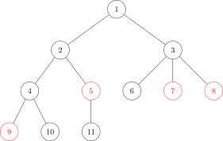
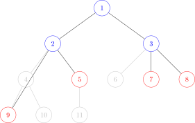
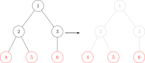
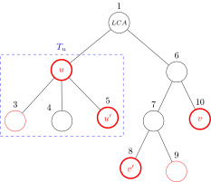
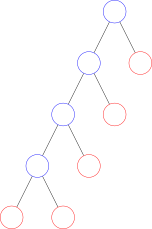
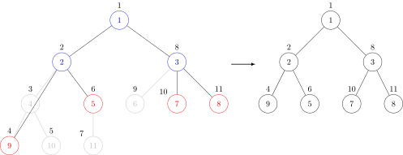
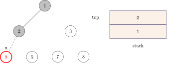
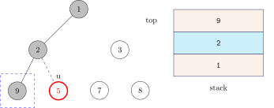

## Table of contents

## Introduction

### What is an auxiliary tree?

An auxiliary tree (also known as a virtual tree) is a technique for solving a class of problems involving queries on a subset of vertices of a given tree.

For standard tree query problems, which can be viewed as a single query over the entire tree, we typically use techniques like centroid decomposition, tree DP, or DSU on tree. If the problem keeps the same question, except now split into $Q$ queries where each query only asks to compute the answer over a given set of vertices, this technique lets us build an auxiliary tree formed from the query vertices along with some extra vertices (effectively discarding the unnecessary vertices from the original tree), and then solve it normally just as in the single-query whole-tree case.

To make this easier to visualize, here is an illustration of an auxiliary tree generated from the original tree:

<div class="figure-pair">
<figure>



<figcaption><em>Original tree</em></figcaption>
</figure>
<figure>



<figcaption><em>Resulting auxiliary tree</em></figcaption>
</figure>
</div>

Here, the red vertices are the query vertices, and the blue vertices are the auxiliary vertices added to the tree. If this still feels vague, don't worry: in the rest of this article, I will focus on explaining how an auxiliary tree works and how to build one, followed by a sample implementation and example problems.

### Prerequisites

To follow this article clearly, you should be familiar with:

- Trees and basic traversals (DFS, BFS).
- Lowest common ancestor (LCA).

### Problem type

Let's look at the following simple problem:

**Problem:** Given a tree with $N$ vertices $(1 \le N \le 2 \cdot 10^5)$, compute the sum of distances between all pairs of vertices in the tree. More specifically, compute:

$$
\sum\limits_{u = 1}^{n}{\sum\limits_{v = u + 1}^{n}{\text{dist}(u, v)}}
$$

where $\text{dist}(u, v)$ is the distance between vertices $u$ and $v$.

This is a familiar problem and can be solved easily with DFS. Now consider a slightly harder version:

**Harder version:** There are $Q$ queries. The $i$-th query gives $k_i$ vertices (the sum of $k_i$ does not exceed $2 \cdot 10^5$) and asks for the sum of distances between all pairs among these $k_i$ vertices.

In this multi-query version, we cannot run DFS over the entire tree for every query. However, there is an important constraint: the sum of $k_i$ is at most $2 \cdot 10^5$. Therefore, if for each query we can find a way to discard the unnecessary vertices and reduce the number of vertices in the tree, the problem is solved.

## How to build an auxiliary tree

An auxiliary tree is formed from the query vertices together with the LCA of all pairs of these vertices, while the remaining vertices have no effect and are discarded. We include the LCA vertices to ensure the vertices remain connected; moreover, the number of distinct LCA vertices will not exceed the number of query vertices, and the relationships between vertices (ancestor–descendant relationships) are preserved from the original tree.

<figure>



<figcaption><em>Illustration of vertices that cannot be connected</em></figcaption>
</figure>

Building an auxiliary tree consists of two main steps:

1. Adding the extra vertices (the LCA vertices).
2. Building the edges of the tree.

### Adding the extra vertices

An important property that makes building the auxiliary tree possible is that even though the number of vertex pairs is very large, the number of distinct LCA vertices is small.

**Theorem 1:** Suppose the number of query vertices is $k$. Then the number of added LCA vertices does not exceed $k - 1$.

**Proof:** Sort the query vertices in increasing DFS visit order to form a list $A$. Consider two vertices $u$ and $v$. There are three cases:

1. Either $u$ or $v$ is an ancestor of the other; in this case, the number of LCA vertices does not change.
2. $u$ and $v$ are adjacent in list $A$: add the LCA of $u$ and $v$ to the tree, increasing the number of LCA vertices by $1$. Since there are at most $k - 1$ such pairs $(u, v)$, the number of LCA vertices increases by at most $k - 1$.
3. $u$ and $v$ are not adjacent in $A$: assume $u$ appears before $v$ in $A$. Let $T_u$ denote the subtree rooted at $u$ in the original tree. Consider $u' \in A$, the last vertex in $T_u$, and $v' \in A$, the first vertex outside $T_u$ that lies in the subtree of the LCA of $u$ and $v$; such a vertex $v'$ always exists because $v$ does not belong to $T_u$. Clearly, their order in $A$ satisfies $u \le u' \lt v' \le v$, and the LCA of $u'$ and $v'$ is also the LCA of $u$ and $v$. In this case, the number of LCA vertices does not change. Illustration (the number on each vertex is its DFS order):

<figure>



<figcaption><em>Example illustrating vertices u, u', v', and v</em></figcaption>
</figure>

**Conclusion:** The number of added LCA vertices will not exceed $k - 1$, and to find all of them, we simply take the LCA of every adjacent pair $u, v$ in $A$. Thus, the size of the auxiliary tree is $\mathcal{O}(2k - 1) = \mathcal{O}(k)$.

An example where the number of LCA vertices equals $k - 1$:

<figure>



<figcaption><em>Case where the number of LCA vertices is maximized</em></figcaption>
</figure>

### Building the edges

After adding the extra vertices (the LCA vertices), the next step is to build the edges of the tree.

Below is an illustration of the algorithm on the auxiliary tree from the beginning of the article:

<figure>



<figcaption><em>Illustration of the auxiliary tree</em></figcaption>
</figure>

Legend:

- Red vertices: query vertices.
- Blue vertices: LCA vertices.
- The number above each vertex represents its DFS visit order.

The algorithm consists of the following steps:

- Sort the query vertices together with the LCA vertices in increasing DFS visit order.
- Push the vertex with the smallest visit order onto the stack (the root of the auxiliary tree); in this case, vertex $1$ in the figure.
- Iterate through the remaining vertices one by one (suppose the current vertex is $u$):
  - If the vertex at the top of the stack is an ancestor of $u$, then it is the direct parent of $u$ in the auxiliary tree (because the vertices are processed in increasing DFS visit order), so we add an edge between $u$ and the vertex at the top of the stack and push $u$ onto the stack. In the figure below, since vertex $2$ is an ancestor of $u = 9$, we add an edge between $2$ and $9$.
    <figure>

    

    <figcaption><em>Illustration of case 1</em></figcaption>
    </figure>

  - Otherwise, we know that the nearest ancestor of $u$ is already in the stack (this vertex always exists because the LCA of $u$ is always processed before $u$), so we pop elements from the stack until the vertex at the top of the stack is an ancestor of $u$. Illustration:
    <figure>

    

    <figcaption><em>Illustration of case 2</em></figcaption>
    </figure>

    In this case, the nearest ancestor of $u = 5$ is vertex $2$; the popped vertices are $\{9\}$, so we add an edge between $2$ and $5$ and push vertex $5$ onto the stack.

The weight of each edge in the auxiliary tree equals the distance between its two vertices in the original tree.

In the end, we obtain the following auxiliary tree:

<figure>


<figcaption><em>Resulting tree</em></figcaption>
</figure>

## Sample implementation

Below is a sample implementation for the problem from the beginning of the article, broken down into the following steps.

### Preprocessing

First, we run a DFS on the original tree to determine the visit order and find the parent of each vertex.

Notation:

- `tin[u]`: the DFS visit order (entry time) of vertex $u$.
- `anc[j][i]`: a sparse table storing the $2^j$-th ancestor of vertex $i$.
- `adj[u]`: the adjacency list of vertex $u$ in the original tree.
- `tout[u]`: the visit order of the last vertex in the subtree rooted at $u$.
- `depth[u]`: the depth of vertex $u$.

```cpp
void dfs(int u, int prev = -1) {
    tin[u] = timer++;
    anc[0][u] = prev;
    for (int v : adj[u]) {
        if (v != prev) {
            depth[v] = depth[u] + 1;
            dfs(v, u);
        }
    }
    tout[u] = timer - 1;
}

void preprocess() {
    dfs(0);
    for (int j = 1; j < LOG; ++j) {
        for (int i = 0; i < n; ++i) {
            anc[j][i] = (anc[j - 1][i] != -1 ? anc[j - 1][anc[j - 1][i]] : -1);
        }
    }
}
```

### Helper functions

Next are a few functions for finding LCAs and supporting the auxiliary tree construction in the following step.

Notation:

- `is_ancestor`: checks whether $u$ is an ancestor of $v$.
- `lca`: finds the LCA of two vertices $u$ and $v$.
- `comp`: compares $u$ and $v$ by their DFS visit order.

```cpp
bool is_ancestor(int u, int v) {
    return tin[u] <= tin[v] && tin[v] <= tout[u];
}

int lca(int u, int v) {
    if (is_ancestor(u, v)) return u;
    if (is_ancestor(v, u)) return v;
    for (int i = LOG - 1; i >= 0; --i) {
        int pu = anc[i][u];
        if (pu != -1 && !is_ancestor(pu, v)) u = pu;
    }
    u = anc[0][u];
    assert(is_ancestor(u, v));
    return u;
}

bool comp(int u, int v) {
    return tin[u] < tin[v];
}
```

### Building the auxiliary tree

This construction step consists of three main stages:

- Sort the vertices in increasing DFS visit order.
- Add the LCA vertices to the vertex set.
- Sort the vertices again in increasing DFS visit order, push the root (the first vertex) onto the stack, and then iterate through each remaining vertex and add the corresponding edges.

Notation:

- `aux_adj[u]`: the adjacency list of vertex $u$ in the auxiliary tree.

```cpp
int build_auxiliary_tree(vector<int> &vers) {
    int sz = (int) vers.size();

    // add LCA vertices.
    sort(vers.begin(), vers.end(), comp);
    for (int i = 0; i < sz - 1; ++i) {
        int new_vertex = lca(vers[i], vers[i + 1]);
        vers.push_back(new_vertex);
    }

    sort(vers.begin(), vers.end(), comp);

    // remove duplicate vertices.
    vers.erase(unique(vers.begin(), vers.end()), vers.end());

    // add edges.
    vector<int> stack;
    int aux_root = vers[0];
    stack.push_back(aux_root);
    for (int i = 1; i < (int) vers.size(); ++i) {
        int u = vers[i];
        while (!stack.empty() && !is_ancestor(stack.back(), u)) stack.pop_back();
        assert(!stack.empty());
        int last = stack.back();
        aux_adj[last].push_back(u);

        stack.push_back(u);
    }
    return aux_root;
}
```

This function returns the root of the auxiliary tree.

### Answering queries

The remaining part is answering each query on the constructed auxiliary tree. Below is a reference solution.

**Solution:** On the constructed auxiliary tree, to compute the sum of distances between the vertices, we count the contribution of each edge to the answer (that is, the number of paths passing through this edge). The answer is the sum of contributions of all edges.

Notation:

- `cnt_important[u]`: stores the number of query vertices in the subtree rooted at $u$.

```cpp
long long dfs2(int u) {
    long long ans = 0;
    for (int v : aux_adj[u]) {
        ans += dfs2(v);
        cnt_important[u] += cnt_important[v];
    }
    for (int v : aux_adj[u]) {
        int dist = depth[v] - depth[u];
        ans += 1LL * dist * cnt_important[v] * (k - cnt_important[v]);
    }
    return ans;
}

void solve() {
    cin >> q;
    for (int qc = 0; qc < q; ++qc) {
        cin >> k;
        vector<int> vers(k);
        for (int i = 0; i < k; ++i) {
            cin >> vers[i];
            --vers[i];
            cnt_important[vers[i]] = 1;
        }
        int aux_root = build_auxiliary_tree(vers);
        long long sum = dfs2(aux_root);
        cout << sum << '\n';

        for (int ver : vers) {
            aux_adj[ver].clear();
            cnt_important[ver] = 0;
        }
    }
}
```

### Complete code

Below is the complete code for the problem from the beginning of the article, combining the functions explained above in order.

```cpp
#include <bits/stdc++.h>
using namespace std;

const int N = (int) 2e5;
const int LOG = 21;
vector<int> adj[N], aux_adj[N];
int depth[N], tin[N], tout[N];
int cnt_important[N];
int anc[LOG][N];
int timer;
int n, q, k;

void dfs(int u, int prev = -1) {
    tin[u] = timer++;
    anc[0][u] = prev;
    for (int v : adj[u]) {
        if (v != prev) {
            depth[v] = depth[u] + 1;
            dfs(v, u);
        }
    }
    tout[u] = timer - 1;
}

void preprocess() {
    dfs(0);
    for (int j = 1; j < LOG; ++j) {
        for (int i = 0; i < n; ++i) {
            anc[j][i] = (anc[j - 1][i] != -1 ? anc[j - 1][anc[j - 1][i]] : -1);
        }
    }
}

bool is_ancestor(int u, int v) {
    return tin[u] <= tin[v] && tin[v] <= tout[u];
}

int lca(int u, int v) {
    if (is_ancestor(u, v)) return u;
    if (is_ancestor(v, u)) return v;
    for (int i = LOG - 1; i >= 0; --i) {
        int pu = anc[i][u];
        if (pu != -1 && !is_ancestor(pu, v)) u = pu;
    }
    u = anc[0][u];
    assert(is_ancestor(u, v));
    return u;
}

bool comp(int u, int v) {
    return tin[u] < tin[v];
}

void read_input() {
    cin >> n;
    for (int i = 0; i < n - 1; ++i) {
        int u, v;
        cin >> u >> v;
        --u; --v;
        adj[u].push_back(v);
        adj[v].push_back(u);
    }
}

int build_auxiliary_tree(vector<int> &vers) {
    int sz = (int) vers.size();

    sort(vers.begin(), vers.end(), comp);
    for (int i = 0; i < sz - 1; ++i) {
        int new_vertex = lca(vers[i], vers[i + 1]);
        vers.push_back(new_vertex);
    }

    sort(vers.begin(), vers.end(), comp);
    vers.erase(unique(vers.begin(), vers.end()), vers.end());

    vector<int> stack;
    int aux_root = vers[0];
    stack.push_back(aux_root);
    for (int i = 1; i < (int) vers.size(); ++i) {
        int u = vers[i];
        while (!stack.empty() && !is_ancestor(stack.back(), u)) stack.pop_back();
        assert(!stack.empty());
        int last = stack.back();
        aux_adj[last].push_back(u);

        stack.push_back(u);
    }
    return aux_root;
}

long long dfs2(int u) {
    long long ans = 0;
    for (int v : aux_adj[u]) {
        ans += dfs2(v);
        cnt_important[u] += cnt_important[v];
    }
    for (int v : aux_adj[u]) {
        int dist = depth[v] - depth[u];
        ans += 1LL * dist * cnt_important[v] * (k - cnt_important[v]);
    }
    return ans;
}

void solve() {
    cin >> q;
    for (int qc = 0; qc < q; ++qc) {
        cin >> k;
        vector<int> vers(k);
        for (int i = 0; i < k; ++i) {
            cin >> vers[i];
            --vers[i];
            cnt_important[vers[i]] = 1;
        }
        int aux_root = build_auxiliary_tree(vers);
        long long sum = dfs2(aux_root);
        cout << sum << '\n';

        for (int ver : vers) {
            aux_adj[ver].clear();
            cnt_important[ver] = 0;
        }
    }
}

int main() {
    cin.tie(nullptr)->sync_with_stdio(false);
    read_input();
    preprocess();
    solve();

    return 0;
}
```

**Complexity:** $\mathcal{O}(N\log{N})$ for preprocessing and $\mathcal{O}(k_i\log{k_i})$ for each query. Since the sum of $k_i$ does not exceed $N$, the overall time complexity is $\mathcal{O}(N\log{N})$.

## Example problems

### [Codeforces - 1702G2](https://codeforces.com/contest/1702/problem/G2)

#### Problem summary

Given a tree with $n$ vertices, a set of vertices is called _passable_ if there exists a path that passes through all of them without traversing any edge twice (the path may also pass through other vertices not in the set).

There are $q$ queries. Each query gives a set of vertices and asks whether this set is _passable_.

#### Constraints

- $1 \le n \le 2 \cdot 10^5$.
- $1 \le q \le 10^5$.
- The total number of vertices across all queries does not exceed $2 \cdot 10^5$.

#### Solution

Observe that a set of vertices is _passable_ when every vertex has at most one child, or at most two children in the case of the root.

For each query, we build the auxiliary tree and check whether the resulting auxiliary tree is _passable_.

Proof of correctness:

- If a set of vertices is _passable_, adding the LCA vertices does not change the answer, because the added LCA vertices also lie on the path.
- If a set of vertices is not _passable_, adding the LCA vertices cannot make it _passable_.

#### Sample implementation

Modify the `solve` function as follows:

```cpp
void solve() {
    cin >> q;
    for (int qc = 0; qc < q; ++qc) {
        cin >> k;
        vector<int> vers(k);
        for (int i = 0; i < k; ++i) {
            cin >> vers[i];
            --vers[i];
        }
        int aux_root = build_auxiliary_tree(vers);
        bool passable = (int) aux_adj[aux_root].size() <= 2;
        for (int i = 1; i < (int) vers.size(); ++i) {
            if ((int) aux_adj[vers[i]].size() > 1) {
                passable = false;
                break;
            }
        }
        cout << (passable ? "YES" : "NO") << '\n';

        // reset values for the next queries
        for (int ver : vers) {
            aux_adj[ver].clear();
        }
    }
}
```

**Complexity:** Since we only iterate over the vertices in the auxiliary tree, the time complexity remains $\mathcal{O}(N\log{N})$.

### [Codechef - YATP](https://www.codechef.com/DEC21A/problems/YATP)

Next, let's look at a problem where every edge in the tree has a weight.

#### Problem summary

Given a weighted tree with $N$ vertices rooted at vertex $1$.

Define $g(u, v)$ as the maximum edge weight on the path from $u$ to $v$.

There are $Q$ queries. Each query gives $K$ distinct vertices $v_1, v_2, \ldots, v_K$ and asks for the sum of $g$ over all pairs of vertices in the given set.

#### Constraints

- $10 \le N \le 10^5$.
- $1 \le Q \le 3 \cdot 10^4$.
- The sum of $K_i$ does not exceed $1.5 \cdot 10^6$.

#### Solution

First, build the auxiliary tree where the weight of edge $(u, v)$ is $g(u, v)$, which can easily be computed using a sparse table and binary lifting (the details are omitted here).

On the auxiliary tree, we compute each edge's contribution to the answer as follows: sort the edges in increasing order of weight and use DSU to add them one by one. When an edge connects two different connected components, all edge weights within those components are guaranteed not to exceed the current edge's weight, so we only need to count the number of paths passing through this edge.

#### Sample implementation

Define the `DSU` struct:

```cpp
struct Dsu {
    int n;
    vector<int> par, sz, cnt_important;
    Dsu() {}
    Dsu(int _n): n(_n), par(n), sz(n), cnt_important(n) {
        for (int i = 0; i < n; ++i) {
            par[i] = i; sz[i] = 1;
        }
    }
    void reset(int u) {
        par[u] = u;
        sz[u] = 1;
    }
    int find(int v) {
        while (v != par[v]) {
            v = par[v] = par[par[v]];
        }
        return v;
    }
    long long unite(int u, int v, int w) {
        u = find(u);
        v = find(v);
        assert(u != v);
        if (sz[u] < sz[v]) swap(u, v);
        sz[u] += sz[v];
        par[v] = u;

        // compute the contribution of edge (u, v).
        long long res = 1LL * w * cnt_important[u] * cnt_important[v];
        cnt_important[u] += cnt_important[v];
        return res;
    }
} dsu;
```

Modify the `solve` function as follows:

```cpp
void solve() {
    dsu = Dsu(n);
    for (int qc = 0; qc < q; ++qc) {
        cin >> k;
        vector<int> vers(k);
        for (int i = 0; i < k; ++i) {
            cin >> vers[i];
            --vers[i];
            dsu.cnt_important[vers[i]] = 1;
        }

        build_auxiliary_tree(vers);

        vector<array<int, 3>> edges;
        for (int u : vers) {
            for (auto [v, w] : aux_adj[u]) {
                edges.push_back({u, v, w});
            }
        }

        // sort the edges in increasing order of weight
        sort(edges.begin(), edges.end(), [](auto a, auto b) {
            return a[2] < b[2];
        });
        long long res = 0;
        for (auto [u, v, w] : edges) {
            res += dsu.unite(u, v, w);
        }
        cout << res << '\n';

        // reset values for the next queries
        for (int ver : vers) {
            aux_adj[ver].clear();
            dsu.cnt_important[ver] = 0;
            dsu.reset(ver);
        }
    }
}
```

**Complexity:** The time complexity is $\mathcal{O}(N\log{N})$.

## Conclusion

In this article, we covered the Auxiliary Tree technique for solving problems involving queries on a subset of vertices of a tree. Hopefully, this gives you a clear overview of Auxiliary Trees and helps you apply the technique to similar problems.

## Practice problems

- [Codechef - Chef and Pairs](https://www.codechef.com/problems/PAIRCNT)
- [Hackerrank HourRank 15 - Kitty's Calculations on a Tree](https://www.hackerrank.com/contests/hourrank-15/challenges/kittys-calculations-on-a-tree/problem)
- [Codechef - Adjacent Leaves](https://www.codechef.com/problems/ADJLEAF2)
- [Codeforces round 614 - D](https://codeforces.com/contest/1292/problem/D)
- [Codeforces round 339 - D](https://codeforces.com/contest/613/problem/D)

## References

- [Codeforces — Virtual tree](https://codeforces.com/blog/entry/76955)
- [Sengxian's blog — Virtual tree](https://blog.sengxian.com/algorithms/virtual-tree)
- [OI Wiki — Virtual tree](https://oi-wiki.org/graph/virtual-tree/)
